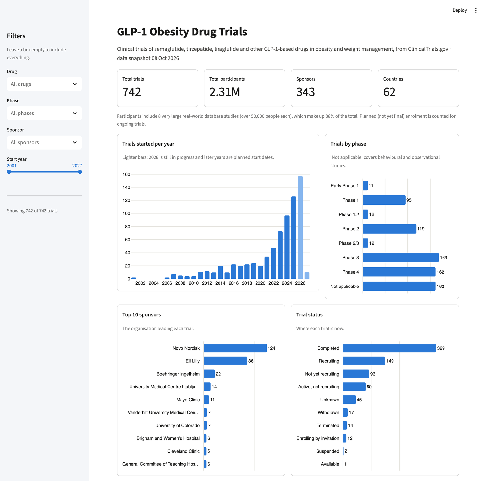
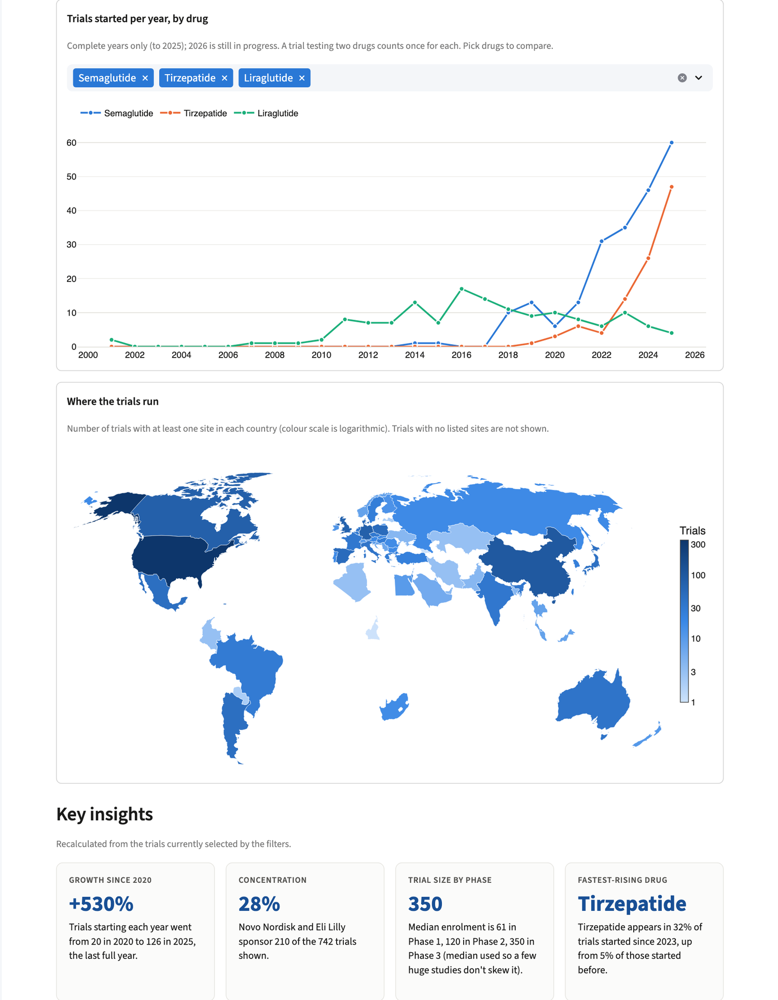

# GLP-1 Obesity Drug Trials Dashboard

An interactive dashboard that analyses **742 clinical trials** of GLP-1-based obesity drugs (semaglutide, tirzepatide, liraglutide and related drugs) registered on [ClinicalTrials.gov](https://clinicaltrials.gov). It shows who is running the trials, how fast the field is growing, which drugs are being tested, and where in the world the studies take place.

Built with Python, pandas, Plotly and Streamlit.

**Live dashboard:** [glp1-trials.streamlit.app](https://glp1-trials.streamlit.app/)





## What it does

- **Headline numbers:** total trials, participants, sponsors and countries.
- **Six interactive charts:** trials started per year, trials by phase, top 10 sponsors, trials by drug over time, a world map of trial locations, and trial status.
- **Sidebar filters:** drug, phase, sponsor and start-year range. Every chart, number and insight updates when you change a filter.
- **Key Insights:** four findings calculated live from the filtered data (nothing is hard-coded).
- **Trial explorer:** a searchable, sortable table with a link from each row to its ClinicalTrials.gov page.

## Key findings (data snapshot 8 October 2026)

- **The field has exploded.** Trials starting each year grew from 20 in 2020 to 126 in 2025 (+530%).
- **Two companies dominate.** Novo Nordisk (124 trials) and Eli Lilly (86) sponsor 28% of all trials.
- **Semaglutide leads, tirzepatide is catching up.** Semaglutide features in 296 trials, tirzepatide in 161 and liraglutide in 146. Tirzepatide appears in 32% of trials started since 2023, up from 5% of those started earlier.
- **Later-phase trials are bigger.** The median trial enrols 61 people in Phase 1, 120 in Phase 2 and 350 in Phase 3.
- **The United States hosts the most trials** (354 with at least one US site), followed by China (100) and Germany (77). Trials span 62 countries in total.

## How the data was built

1. **Fetch** (`fetch_trials.py`): queries the [ClinicalTrials.gov API v2](https://clinicaltrials.gov/data-api/api) for trials with an obesity, overweight or weight-management condition and one of nine GLP-1-based drugs or combinations (semaglutide, tirzepatide, liraglutide, dulaglutide, exenatide, retatrutide, survodutide, cagrilintide/CagriSema, orforglipron). Keeps trial ID, title, interventions, sponsor, phase, status, start and completion dates, enrolment and countries.
2. **Clean** (`clean_trials.py` and `config.py`):
   - **Relevance filter:** the API also matches drug words buried in long descriptions, so 30 trials with no GLP-1 drug in their interventions or title (e.g. dental hygiene or diet studies) were removed, leaving 742.
   - **Drugs:** 700+ different intervention names ("Wegovy", "semaglutide 2.4 mg", "LY3437943"...) are grouped into one consistent drug name, including brand names and lab codes. A trial testing two drugs counts for each.
   - **Sponsors:** name variants are merged ("Novo Nordisk A/S" becomes "Novo Nordisk", "Gan & Lee Pharmaceuticals." and "Gan and Lee Pharmaceuticals, USA" become one).
   - **Missing values:** phase "not applicable" is kept as its own group; missing dates, enrolment and countries are left blank rather than guessed, so they are excluded from calculations that need them.
   - **Countries:** old or inconsistent names are tidied (e.g. "Turkey (Türkiye)" to "Turkey").
3. **Save:** the result is stored in `data/glp1_trials_clean.csv`, so the dashboard loads instantly and never calls the API.

## Limitations

- This is **registry data, not results**: it records that a trial was registered, not whether the drug worked.
- **Enrolment is part planned, part actual** (350 of 742 trials show estimated numbers). A few huge real-world database studies (8 studies of over 50,000 people each) make up 88% of the 2.3 million "participants", so the dashboard flags this and uses medians for typical trial size.
- **Countries come from listed trial sites.** 41 trials list no sites, so they are missing from the map and country count.
- **Trial selection uses keywords.** A few trials may be wrongly included or missed, for example when a drug is only a comparator arm or is described unusually.
- **The latest years are incomplete.** Trials starting in 2026 and later include planned start dates, so the most recent year looks different from complete years.

## Run it yourself

You need Python 3.10 or newer.

```bash
git clone https://github.com/hassanimtiaz-dev/glp1-trials-dashboard.git
cd glp1-trials-dashboard
pip install -r requirements.txt
streamlit run app.py
```

The dashboard opens at http://localhost:8501.

To refresh the data from ClinicalTrials.gov:

```bash
python3 fetch_trials.py
python3 clean_trials.py
```

## Project structure

```
app.py                  The Streamlit dashboard
fetch_trials.py         Downloads trials from the ClinicalTrials.gov API
clean_trials.py         Cleans and standardises the data
config.py               Cleaning rules: drug names, sponsor merges, labels, country codes
data/                   Cleaned CSV and snapshot date (the raw download is not stored)
docs/                   Screenshots used in this README
requirements.txt        Python packages
.streamlit/config.toml  Dashboard theme
```

## How it was built

I set the project scope: the question, which drugs and which kinds of trial count. The code was written with [Claude Code](https://claude.com/claude-code), Anthropic's agentic AI coding assistant, and I reviewed the results.

## Data source

Trial data comes from ClinicalTrials.gov, a public registry run by the US National Library of Medicine. This project is independent and is not affiliated with it.
